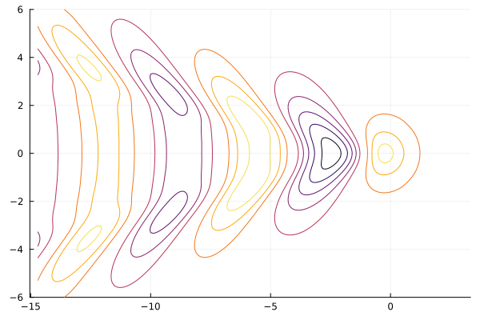
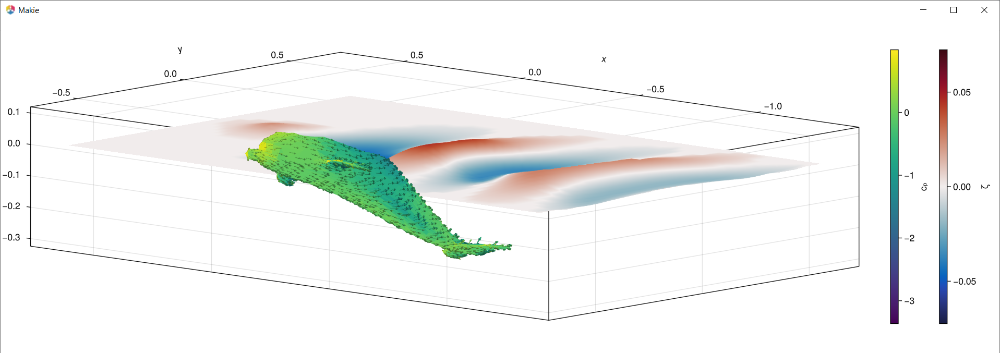
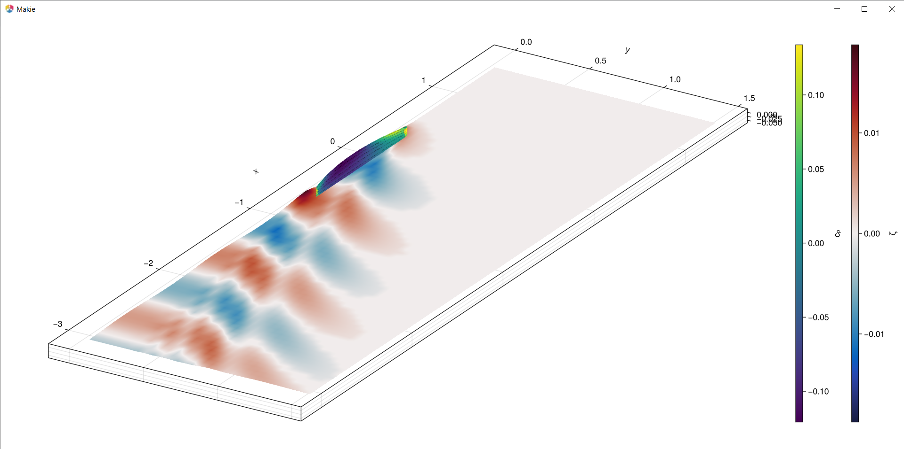
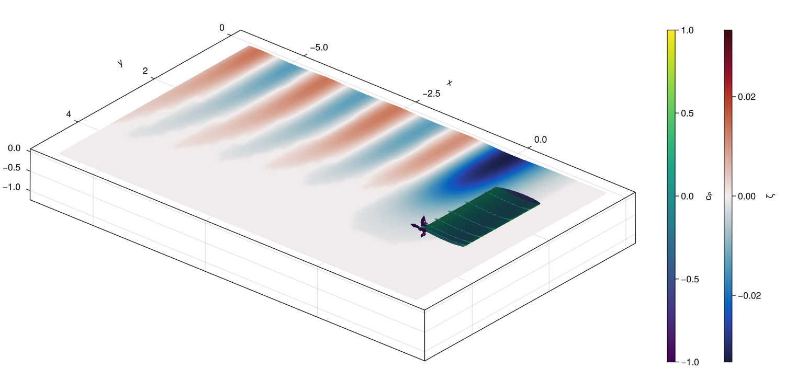
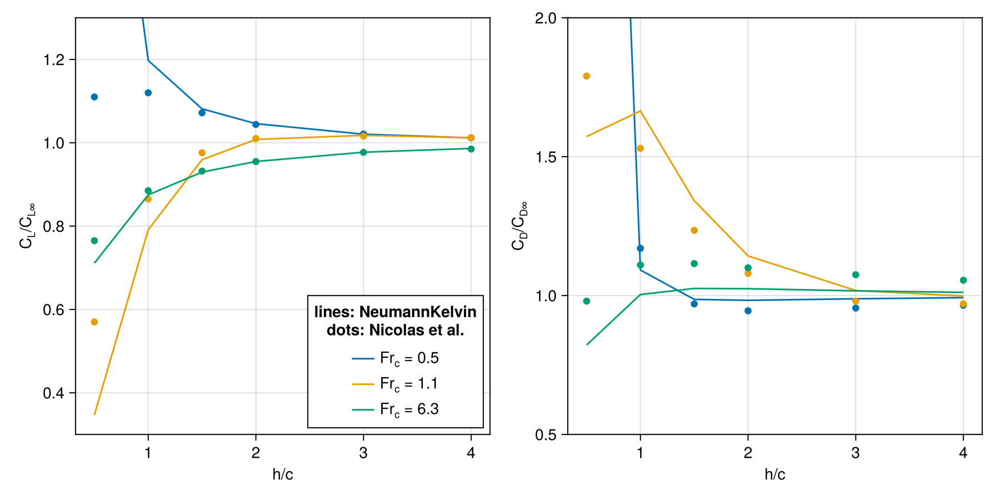

# NeumannKelvin.jl

[](https://github.com/weymouth/NeumannKelvin.jl/actions/workflows/CI.yml?query=branch%3Amain)



Calculation of the linear free-surface potential using Neumann boundary conditions on source panels and Kelvin Green's functions.

## Capabilities

A potential flow problem is a fluid domain with boundary conditions. Each condition is either built into the Green function of the domain, or applied on panels covering that boundary. This package defines a `PanelSystem` combining:
1. A fluid `domain`, whose Green function satisfies its own boundary conditions:
   - `Unbounded` potential flow, optionally with symmetry planes applied using the method of images.
   - `Kelvin` potential flow below a free surface, whose Green function satisfies the linear FSBC (free-surface boundary condition) on `z=0`.
2. The panelled `boundaries`, each applying its own boundary condition:
   - A solid body, defined using a set of source panels with the Neumann (flow tangency) condition applied to each panel.
   - A `FreeSurface`, defined using a set of source panels with the linear FSBC applied to each panel.
   - A `Lifting` body, defined using a closed set of dipole panels with zero potential inside, and a wake whose strength is set by the Kutta condition.

The package also defines:
 - `PanelTree` struct to accelerate the evaluation of the potential over a set of panels using a Barnes-Hut style monopole approximation for panels far from the query point.
 - `directsolve!`,`gmressolve!` functions to solve for the system source strengths.
 - Functions to measure the induced potential `Φ` and its various "downstream" properties `∇Φ,u,cₚ,steadyforce,addedmass,ζ`, where all derivatives are computed using `ForwardDiff.jl`.

## Installation & version info

The package is registered, so after installing Julia (version ≥1.10), you only need to open the REPL and type
```julia
] add NeumannKelvin
```
The first install will take a few seconds as a few functions precompile, but the following times should be immediate.

The solver is still in development (v0.10), but the interface and methods are stabilizing. We should be ready for v1.0 after feedback from users.

## Basic usage

The panels themselves can either be defined by reading in a Mesh of planar polygons or by measuring a parametric surface. For example a spheroid under the free-surface may be defined as:
```julia
using NeumannKelvin
h = 0.1 # spacing
freesurf = measure.((u,v)->SA[u,-v,0],2:-h:-4,(-2:h:2)',h,h)
S(θ₁,θ₂) = SA[0.5cos(θ₁),-0.1sin(θ₂)*sin(θ₁),0.1cos(θ₂)*sin(θ₁)-0.15]
body = panelize(S,0,π,0,2π,hᵤ=h)
```
The `measure` function measures a parametric surface into a single panel given a center and extent in `u,v`. Here, we broadcast `measure` over a simple planar surface to define the free-surface mesh `freesurf`. The `panelize` function generalizes this procedure, adaptively sampling a parametric surface over a given `u,v` range to achieve a desired spacing and deviation tolerance between the panels and original surface. The `panelize` function returns a `Table` from TypedTables.jl since the method won't generally form a structured grid. See the documentation for `measure`, `panelize` for details.

Next the panel system can be defined and solved. For an unbounded potential flow solution with a small number of panels like this one, we can use
```julia
julia> sys = PanelSystem(body) |> directsolve!
┌ Warning: This routine is memory intensive. See help?>directsolve!.
  0.000352 seconds (116 allocations: 167.154 KiB)
PanelSystem
  domain: Unbounded(mirrors=([1, 1, 1],))
  background flow U: [-1, 0, 0]
  boundary: Table with 10 columns and 96 rows
  body area & volume: 0.5019560344518552, 0.02079102608593207
```
You can see the domain, flow, boundaries, and some basic properties of the panelized body. You can also see the solution method is very fast, about 350μs for this small 96 panel system.

For larger systems, it's very helpful to accelerate the solution by wrapping the panels in a `PanelTree` and using the matrix-free iterative solver:
```julia
julia> bigbody = panelize(S,0,π,0,2π,hᵤ=1/200,N_max=Inf); #20k panels

julia> sys = PanelSystem(PanelTree(bigbody)) |> gmressolve!
SimpleStats
 niter: 4
 solved: true
 inconsistent: false
 indefinite: false
 npcCount: 0
 residuals: []
 Aresiduals: []
 κ₂(A): []
 allocation timer: 111.50μs
 timer: 767.66ms
 status: solution good enough given atol and rtol

PanelSystem
  domain: Unbounded(mirrors=([1, 1, 1],))
  background flow U: [-1, 0, 0]
  boundary: PanelTree(20096 panels, 16 levels, θ²: 9)
  body area & volume: 0.5019251097019334, 0.020944737007987515
```
This 20k panel system still takes less than a second to solve using this approach. See the documentation for `PanelTree` and `gmressolve!` for details. 

Since this body is symmetric in y, we could further increase the speed by using half of the body in a domain which is symmetric in y. The `Unbounded` Green function applies the method of images on the symmetry plane.
```julia
julia> halfbody = panelize(S,0,π,0,π,hᵤ=1/200,N_max=Inf); # half the θ₂ range

julia> PanelSystem(PanelTree(halfbody),domain=Unbounded(sym_axes=2)) |> gmressolve!
SimpleStats
 niter: 4
 solved: true
 inconsistent: false
 indefinite: false
 npcCount: 0
 residuals: []
 Aresiduals: []
 κ₂(A): []
 allocation timer: 66.70μs
 timer: 444.00ms
 status: solution good enough given atol and rtol

PanelSystem
  domain: Unbounded(mirrors=([1, -1, 1], [1, 1, 1]))
  background flow U: [-1, 0, 0]
  boundary: PanelTree(10048 panels, 15 levels, θ²: 9)
  body area & volume: 0.25096255485096675, 0.01047237643741015
```
Where we see half the number of panels and approximately half the solve time.

With the system solved, we can now measure any properties of interest. For example, the extreme values of the pressure coefficient and the added mass.
```julia
julia> extrema(cₚ(sys))
(-0.12317301867194641, 0.9783847521294856)

julia> addedmass(sys)
3-element SVector{3, Float64} with indices SOneTo(3):
 0.05901657514120391
 6.955271772423463e-5
 3.081097114965209e-5
```
The max cₚ=1 because of the stagnation point, but the added mass is small because the flow direction was aligned with the long axis of the spheroid. We can compute the other added mass coefficient by rotating the body or (easier) the background flow U:

>**Note:** You may use any length-units you want to define the body, but you must then use the same length-scale within `U`. Body volumes and areas will also be given in those units (squared & cubed). Measurements such as `cₚ`, `addedmass`, `steadyforce` and the free-surface elevation `ζ` all return dimensionless values (scaled by `|U|`, body area, volume, etc). See the documentation for each function.

```julia
julia> directsolve!(PanelSystem(body,U=SA[0,-1,0]),verbose=false) |> addedmass
3-element SVector{3, Float64} with indices SOneTo(3):
  1.2222094432762491e-18
  0.842469234761613
 -3.181818583995835e-17
```
The added mass force is larger when the flow is broadside to the body, as expected.

## Free surface panels

For our first free-surface simulation, we can define a `PanelSystem` with two boundaries; the `body` and a `FreeSurface` of `freesurf` panels. We also **must** define the Kelvin length ℓ≡U²/g to apply the FSBC.
```julia
# Make the free-surface grid and body panels using y-symmetry and resolving ℓ
ℓ = 1/4; h = 0.3ℓ # Kelvin-length and spacing
freesurf = measure.((u,v)->SA[u,-v,0],2:-h:-4,(h/2:h:2)',h,h)
halfbody = panelize(S,0,π,0,π,hᵤ=h)
```
```julia
julia> FSsys = PanelSystem((PanelTree(halfbody;θ²=16),FreeSurface(freesurf;ℓ,θ²=16)),
                          domain=Unbounded(sym_axes=2)) |> gmressolve!
SimpleStats
 niter: 100
 solved: true
 inconsistent: false
 indefinite: false
 npcCount: 0
 residuals: []
 Aresiduals: []
 κ₂(A): []
 allocation timer: 429.70μs
 timer: 1.46s
 status: solution good enough given atol and rtol

PanelSystem
  domain: Unbounded(mirrors=([1, -1, 1], [1, 1, 1]))
  background flow U: [-1, 0, 0]
  boundary: PanelTree(72 panels, 8 levels, θ²: 16)
  boundary: FreeSurface((81, 27) panels, ℓ=0.25)
  body area & volume: 0.25097206316425236, 0.010422384596360848
```
The `FreeSurface` panels are wrapped in a `PanelTree` by default (because the free-surface meshes are unavoidably large) but you can disable this using `wrap=identity` or adjust the Barnes-Hut cutoff using the `θ²` keyword argument.

Currently, you **must** use the matrix-free `gmressolve!` with a `FreeSurface` because the FSBC influence matrix hasn't been implemented. The preconditioner is also fairly basic, and this might be worth optimizing in the future to reduce the number of GMRES iterations.

Despite the large number of panels and increased iterations, the solve is still fast and we can now measure the steady wave force
```julia
julia> steadyforce(FSsys)
3-element SVector{3, Float64} with indices SOneTo(3):
 -0.020322449400870708
 -0.09702212943654714
  0.009539807044513293
```
Note that we've used y-symmetry, and integrating over the half-body artificially produced a non-zero side force. However, the dynamic drag and vertical forces coefficients have been appropriately scaled by the (half) body surface area.

We can also solve flows around surface piercing bodies. As a fun illustration of a Mesh-defined body, we can use a dolphin geometry!
```julia
# Load the mesh, xform it, and filter out panels intersecting z=0
using GeometryBasics,FileIO
function affine(mesh, A, b)  # rotate, scale, and shift the mesh
    position = [Point3f(A * p + b) for p in mesh.position]
    GeometryBasics.Mesh(position, mesh.faces)
end
dolphin = let 
    mesh = load("examples//LowPolyDolphin.stl")
    mesh = affine(mesh, SA[0 -1 0;1 0 0;0 0 1]/65,SA[0.043,0,-0.09])
    filter(p->abs(p.x[3])>0.01, panelize(mesh))
end

# The rest of the system matches the example above
h,s = 4f-2, 66f-2; freesurf = measure.((u,v)->SA[u,-v,0],s:-h:-2s,(-s:h:s)',h,h); # Float32 to match the Mesh
sys = PanelSystem((PanelTree(dolphin),FreeSurface(freesurf;ℓ=9f-2))) |> gmressolve!
```
```julia
PanelSystem
  domain: Unbounded(mirrors=([1, 1, 1],))
  background flow U: [-1, 0, 0]
  boundary: PanelTree(1373 panels, 12 levels, θ²: 9)
  boundary: FreeSurface((50, 34) panels, ℓ=0.09)
  body area & volume: 0.4362399, 0.013043594
```
Note that the body panel type is `PolyKernel` because it is defined by the STL Mesh instead of a parametric surface. `PolyKernel` panels integrate the source potential exactly over any planar polygon.

Let's take a look at the geometry and flow using Makie!
```julia
using GLMakie # or any other Makie backend, e.g. WGLMakie for browsers
viz(sys)
```


The `viz` function defines a few default visualizations for body and free-surface panel systems.

## Neumann-Kelvin domain

We can satisfy the linear FSBC by construction if we switch to the `Kelvin` domain, whose Green function satisfies the linear FSBC on `z=0`. This has the huge advantage of perfectly resolving the linear wavefield with no free-surface panels and (after lots of optimized integral methods) much faster solve times!

Here's the same submerged spheroid example solved in the Kelvin domain.
```julia
ℓ = 1/4; h = 0.3ℓ # Kelvin-length and spacing
halfbody = panelize(S,0,π,0,π,hᵤ=h)
```
```julia
julia> NKsys = PanelSystem(halfbody,domain=Kelvin(ℓ,sym_axes=2)) |> directsolve!
┌ Warning: This routine is memory intensive. See help?>directsolve!.
  0.002485 seconds (116 allocations: 104.498 KiB)
PanelSystem
  domain: Kelvin(ℓ=0.25, mirrors=([1, -1, 1], [1, 1, 1]), filter=true, contour=false)
  background flow U: [-1, 0, 0]
  boundary: Table with 10 columns and 72 rows
  body area & volume: 0.25097206316425236, 0.01042238459636084

julia> steadyforce(NKsys)
3-element SVector{3, Float64} with indices SOneTo(3):
 -0.021857839611607574
 -0.09583414604004664
  0.009237706149040225
```
It is encouraging that the `FreeSurface` panel solution and forces match to within a few percent of the `Kelvin` domain solution despite that method's finite free-surface quadrature, numerical wave damping and (potentially) reflections.

The `Kelvin` domain solve is much faster than using `FreeSurface` panels - in fact it is only around 7x slower than a double body flow computed by reflecting the body across `z=0`, which can't predict drag and gets the wrong vertical force as well!
```julia
julia> PanelSystem(halfbody,domain=Unbounded(sym_axes=(2,3))) |> directsolve! |> steadyforce
┌ Warning: This routine is memory intensive. See help?>directsolve!.
  0.000346 seconds (116 allocations: 105.451 KiB)
3-element SVector{3, Float64} with indices SOneTo(3):
 -2.413321661208678e-12
 -0.07406809807845048
  0.006010113760375885
```

Despite many advantages, the `Kelvin` domain does have its own limitations:

- The inhomogeneous Kelvin Green's function means you can't use `PanelTrees` to accelerate Kelvin panels. 
- The perfect wave resolution can produce waves too small for the body panels near the free-surface to resolve, leading to convergence issues unless these are `filter`ed.
- Kelvin panels can not be extended to inforce the Nonlinear FSBC, unlike `FreeSurface` panels which could potentially do so in the future.

See the docs for `Kelvin`, `kelvin`, and the cited references for details.

As a final application, let's simulate the classic Wigley hull in the `Kelvin` domain
```julia
function wigley(hᵤ,hᵥ=hᵤ;B=1/8,D=1/6,kwargs...)
    S(u,v) = SA[u-0.5,-2B*u*(1-u)*(v)*(2-v),D*(v-1)]
    panelize(S;hᵤ,hᵥ,kwargs...)
end
NKsys = PanelSystem(wigley(0.025),domain=Kelvin(1/2π,sym_axes=2,contour=true)) |> directsolve!
viz(NKsys)
```

This is a fisheye view so you can see the pressure distribution and the high-resolution wave pattern. The `contour=true` flag turns on the waterline contour contribution to the potential, although this is a small contribution for the fine-bow of the Wigley hull.

## Lifting surfaces

A `Lifting` boundary is a closed body of dipole panels (the derivative of a source panel) with a flat wake trailing to x=-∞ from each trailing edge, and the wake strength set by the Kutta condition. The panels must share vertices, which `panelize` grids don't, so the mesh is built directly. [examples/hydrofoil.jl](examples/hydrofoil.jl) builds the rectangular H105 hydrofoil of [Nicolas et al. (2023)](https://doi.org/10.5957/jst/2023.8.10.183) (aspect ratio 4, α=2°) with rounded tips. Its core is
```julia
foil,te = wing(h=1) # define foil geometry and trailing edge at depth `h=1`
sys = PanelSystem(Lifting(foil,te),domain=Kelvin(0.5^2,sym_axes=2)) |> directsolve! # Fn_chord = 0.5
steadyforce(sys;S=2) # lift & drag on the half-wing area
waves = viz(sys,colorrange=(-1,1),fsargs=(x=-6:1/8:2,y=0:1/6:5)); resize!(waves,1200,600)
```


This fisheye view shows the pressure side of the foil and its wave pattern. 

Sweeping the depth and Froude number, the lift relative to its deep-water value matches the boundary element results of Nicolas et al. within 0.01 for h/c ≥ 1.5, including the gain at low Froude number and the loss at high Froude number, although the linear Neumann-Kelvin method diverges when the depth is very small.



Nicolas et al. use the boundary element code PUFFIn and [Perali et al. (2024)](https://archimer.ifremer.fr/doc/00904/101579/113081.pdf) report that a typical PUFFIn case takes a few minutes on a desktop computer. In contrast, our linear `Lifting+Kelvin` prediction takes about 0.3 s per case above on a 20-thread laptop.